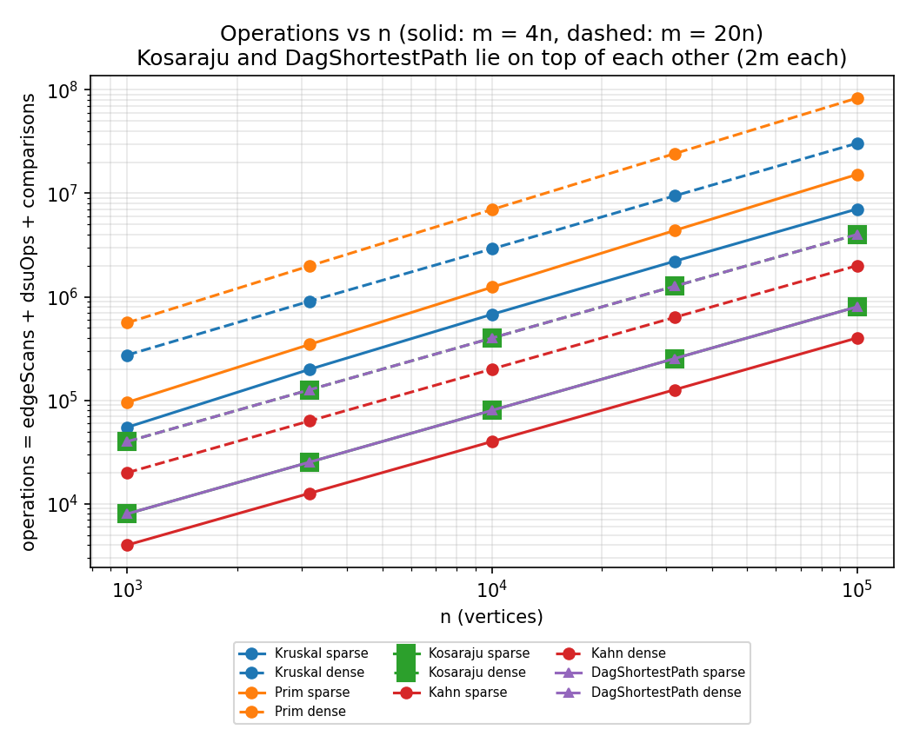
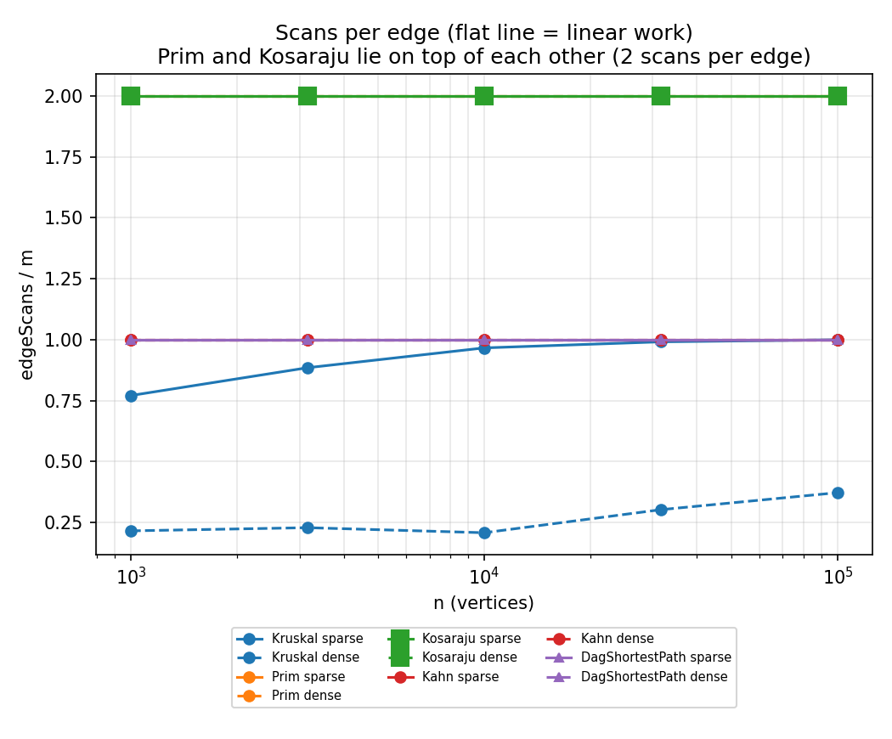
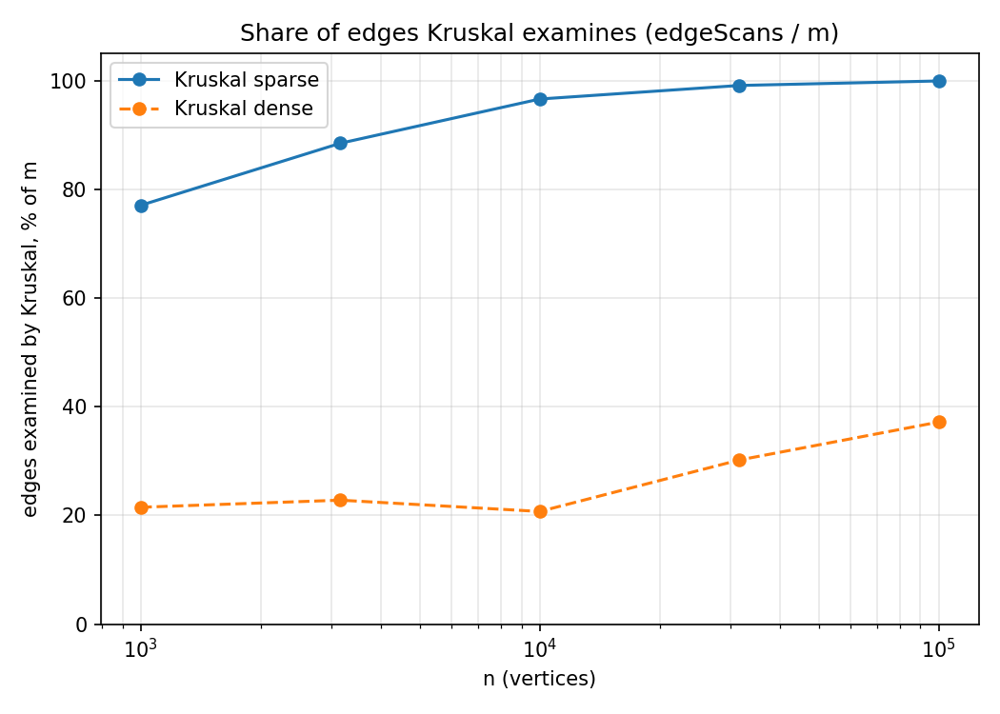

# Assignment 3

All numbers in this report come from `results/results.csv`
The benchmark checks itself: Kruskal weight = Prim weight, the topological order is valid, Kosaraju scans exactly 2m edges,
Kahn and the DAG pass scan exactly m edges, and all 10 reference values (MST weight, SCC count, sum of DAG distances)
from the assignment are reproduced exactly. If one check fails, the run stops with an exception and no CSV is written.

## 1. Complexity table

V = number of vertices, E = number of edges, alpha = inverse Ackermann function (below 5 for any real n).

| Algorithm | Time | Extra space | Why |
|---|---|---|---|
| DSU find / union | O(alpha(n)) amortized | O(n) | union by rank keeps trees low, path compression flattens them; two arrays `parent`, `rank` |
| Kruskal | O(E log E) | O(V + E) | sorting E edges dominates, then at most E times find/union (almost O(1)); sorted copy of the edge list + DSU |
| Prim (PriorityQueue) | O(E log E) = O(E log V) | O(V + E) | every edge can be pushed once, each push/poll costs O(log E); queue may hold up to E entries (lazy version, stale entries are skipped) |
| Kosaraju | O(V + E) | O(V + E) | two DFS passes, each edge is looked at once per pass; reversed graph copy + arrays + own stack of size V |
| Kahn | O(V + E) | O(V) | every vertex enters the queue once, every edge is scanned once when its start vertex leaves the queue; arrays `indeg` and queue |
| DAG shortest paths | O(V + E) (given the topological order) | O(V) | one pass in topological order, every edge relaxed once; arrays `dist`, `parent` |

## 2. Counters vs formulas

| Algorithm: counter / formula | n=1000 | 3162 | 10000 | 31623 | 100000 |
|---|---|---|---|---|---|
| Kosaraju: edgeScans / (V+E), sparse | 1.600 | 1.600 | 1.600 | 1.600 | 1.600 |
| Kosaraju: edgeScans / (V+E), dense | 1.905 | 1.905 | 1.905 | 1.905 | 1.905 |
| Kahn: edgeScans / (V+E), sparse | 0.800 | 0.800 | 0.800 | 0.800 | 0.800 |
| Kahn: edgeScans / (V+E), dense | 0.952 | 0.952 | 0.952 | 0.952 | 0.952 |
| DAG paths: edgeScans / (V+E), sparse | 0.800 | 0.800 | 0.800 | 0.800 | 0.800 |
| DAG paths: edgeScans / (V+E), dense | 0.952 | 0.952 | 0.952 | 0.952 | 0.952 |
| Prim: edgeScans / E, sparse and dense | 2.000 | 2.000 | 2.000 | 2.000 | 2.000 |
| Prim: comparisons / (E log2 E), sparse | 1.829 | 1.865 | 1.895 | 1.921 | 1.934 |
| Prim: comparisons / (E log2 E), dense | 1.825 | 1.847 | 1.866 | 1.878 | 1.890 |
| Kruskal: dsuOps / E, sparse | 2.290 | 2.519 | 2.682 | 2.732 | 2.748 |
| Kruskal: dsuOps / E, dense | 0.580 | 0.606 | 0.565 | 0.754 | 0.894 |
| Kruskal: dsuOps / edgeScans, sparse | 2.972 | 2.848 | 2.776 | 2.757 | 2.751 |
| Kruskal: dsuOps / edgeScans, dense | 2.697 | 2.657 | 2.723 | 2.497 | 2.403 |
| Kruskal: comparisons / (E log2 E), sparse | 0.891 | 0.907 | 0.869 | 0.809 | 0.745 |
| Kruskal: comparisons / (E log2 E), dense | 0.903 | 0.846 | 0.784 | 0.720 | 0.666 |

What I see:

* **Kosaraju, Kahn, DAG paths:** the ratio is exactly constant (it equals 2E/(V+E) or E/(V+E), which depends only on the density). This is the clean confirmation of O(V + E).
* **Prim:** it scans every adjacency entry once, so 2 scans per edge, always. The comparisons / (E log2 E) ratio is between 1.8 and 1.94 and moves very slowly, it does not grow. So Prim is O(E log E) with a constant near 2.
* **Kruskal, dsuOps:** on sparse graphs dsuOps / E goes 2.29 -> 2.75 and flattens. On dense graphs dsuOps / E is *not* flat (0.58 -> 0.89). The reason is that Kruskal stops as soon as the tree has n-1 edges, so it looks only at a part of the edges (see section 6, plot 3), and this part grows with n. If I divide by the edges Kruskal really looked at (edgeScans), the ratio is about 2.4 - 3.0 for all sizes. It makes sense: every examined edge costs 2 finds, every accepted edge adds 3 more (2 finds inside union + 1 union), so dsuOps = 2 * edgeScans + 3 * (n-1), that is almost constant per examined edge.
* **Kruskal, comparisons:** the ratio is always below 1 and slowly goes down. I think the reason is that all weights are from 1..1000, so there are many equal keys and Java's sort (TimSort) needs fewer comparisons than E log2 E. Anyway the ratio does not grow, so the E log E upper bound holds.

## 3. Slope check (log-log fit of edgeScans against n)

| Algorithm | slope sparse | slope dense |
|---|---|---|
| Kosaraju | 1.000 | 1.000 |
| Kahn | 1.000 | 1.000 |
| DAG shortest paths | 1.000 | 1.000 |
| Prim | 1.000 | 1.000 |
| Kruskal | 1.055 | 1.119 |

The traversals give slope 1.00 (linear work). Kruskal is steeper (1.06 and 1.12) because the share of examined edges grows with n.
The log factor shows up in the *comparisons* counter: its slope is 1.05 (sparse) and 1.02 (dense) for Kruskal and 1.11 / 1.09 for Prim, all a bit above 1. That is what E log E looks like on a log-log plot over only two decades of n (a log factor makes the slope slightly bigger than 1, not 2).

## 4. Correctness arguments

**Cut property (why Kruskal and Prim are correct).**
Let A be a set of edges that is part of some minimum spanning tree T. Take a cut (S, V\S) that no edge of A crosses, and let e be a lightest edge that crosses it.
Claim: A + {e} is still part of some MST. If e is already in T, nothing to prove. If not, adding e to T makes a cycle; this cycle crosses the cut at least twice, so it has another edge f that crosses the cut.
f is not in A, because A does not cross the cut. Now T' = T - f + e is again a spanning tree, and w(T') = w(T) - w(f) + w(e) <= w(T), because e is a lightest edge across the cut. So T' is also an MST and it contains A + {e}.
*Kruskal:* the edge e = (u, v) that it accepts connects two different components C1 and C2 of the current forest A. The cut (C1, rest) is not crossed by A, and e is the lightest edge across it that is left (lighter edges were looked at before: they were inside a component, or they were accepted). So e is safe.
*Prim:* the cut is (vertices already in the tree, the others). The tree edges do not cross it, and the PriorityQueue gives the lightest edge that leaves the tree, so this edge is safe too. By induction after n-1 safe steps we have an MST, so both algorithms give the same total weight (but maybe different trees, when weights are equal).

**Induction on the topological order (why one pass is enough in a DAG).**
Let d(v) be the real shortest distance to v from any source (vertex with in-degree 0). Claim: when v is taken from the topological order, dist[v] = d(v).
First, dist[v] is always the length of some real path, so dist[v] >= d(v) at any moment.
Base: the first vertex in the order has no incoming edges (its predecessors would stand before it), so it is a source and dist = 0 = d.
Step: take v. The last edge of a shortest path to v is (u, v), and u stands before v in the order. By the induction assumption dist[u] = d(u) when u was processed, and then we relaxed (u, v), so dist[v] <= d(u) + w(u, v) = d(v). Together with dist[v] >= d(v) we get equality.
All incoming edges of v are relaxed before v is processed, because all predecessors stand earlier, so we never need to come back to a vertex. Therefore one pass, O(V + E).
**Negative weights:** the proof never uses w >= 0, so they are fine. Dijkstra needs w >= 0 because it "closes" the closest vertex and believes that no later edge can make it shorter; a negative edge can. In a general graph a negative *cycle* makes the shortest distance undefined (go around again and again). A DAG has no cycles at all, so there are no negative cycles and every shortest path has at most V-1 edges.

## 5. Which algorithm when

| Situation | My choice | Why |
|---|---|---|
| Undirected, MST, edges come as a list, sparse (m ~ 4n) | Kruskal | no adjacency list needed; DSU is almost free; it looks at ~100% of the edges anyway (plot 3), but the sort is cheap |
| Undirected, MST, dense (m ~ 20n) | Kruskal (on my graphs) | it looks at only 21-37% of the edges and its total counted operations are lower than Prim's (30M vs 83M at n = 100 000). For a really dense graph (E near V^2) I would take Prim with an array instead of a heap, O(V^2), and no sort |
| MST, graph already in adjacency list, or growing the tree from a given vertex | Prim | no sorting of all edges, works directly on adjacency lists; 2 scans per edge |
| Disconnected graph | both give a forest | both return the number of components, no exception |
| Directed, cycles possible, need "who is in a deadlock" | Kosaraju (SCC) | O(V + E); each SCC with more than one vertex (or a self-loop) is a deadlock |
| Directed, need a valid run order, cycle possible | Kahn | O(V + E); if fewer than n vertices leave the queue, there is a cycle and I report it |
| DAG, shortest path (also with negative weights) | Kahn + one relaxation pass | O(V + E), simpler and faster than Dijkstra, and negative weights are OK |
| General graph, no negative weights | Dijkstra (not in this assignment) | the DAG trick does not work when there are cycles |
| General graph with negative weights | Bellman-Ford (used only in my tests) | O(V * E), detects negative cycles |
| Edge list vs adjacency list | Kruskal wants an edge list (sort), Prim / Kosaraju / Kahn want an adjacency list | converting one into the other costs O(V + E), which is cheap |

## 6. Plots

1. Operations vs n (log-log): `results/plots/1_operations_vs_n.png`

   

   All lines are straight and go up with a similar slope. Kruskal and Prim are higher because of the log factor (sorting / heap comparisons).
   Kosaraju and DagShortestPath have the same operation count (2m), so their lines lie on top of each other.

2. Scans per edge, edgeScans / m vs n: `results/plots/2_scans_per_edge.png`

   

   Flat lines: Kahn and DAG paths = 1, Prim and Kosaraju = 2. This is the confirmation of linear work.
   Only Kruskal is not flat, because it stops early.

3. Share of edges that Kruskal examines: `results/plots/3_kruskal_share.png`

   

   On sparse graphs Kruskal looks at 77% -> 99.9% of the edges: the graph is only just connected, so the heaviest edge of the MST is near the end of the sorted list and Kruskal has to go almost to the end.
   On dense graphs it looks at only 21% -> 37%: there are many cheap edges, the graph becomes connected early and Kruskal stops. Prim cannot do that: it always scans every adjacency entry (2m).
   This is why Kruskal gains more on dense graphs.

## 7. Stack depth (maxDepth)

Kosaraju uses its own stack. The deepest it got (n = 100 000): 59 668 on the sparse graph and 91 920 on the dense graph.
A recursive DFS would need that many nested calls and would crash with `StackOverflowError`. The unit test with a path of 100 000 vertices
(maxDepth = 100 000) passes. The full table is in `results/ratios.md`.

## 8. A paragraph about time

The median of 5 runs is in the `time_ms` column of the CSV. For example at n = 100 000 (sparse / dense) I measured about:
Kruskal 81 / 457 ms, Prim 309 / 1971 ms, Kosaraju 176 / 995 ms, Kahn 16 / 85 ms, DAG paths 18 / 86 ms.
The order of the algorithms looks the same as in the counters (Kahn and DAG paths are the cheapest, Prim the most expensive), but I do not use the clock as evidence.
On the small graphs (n = 1000, 3162) the times are mostly noise: the JVM is still warming up (JIT compilation), garbage collection can start at any moment,
for example Kruskal at n = 1000 took 9 ms although it did only 42 000 comparisons. Times also depend on the laptop, the JDK version and what else is running.
The counters are the same on every machine, so my conclusions come from the counters.